# Báo Cáo Sửa Lỗi & Cải Tiến Giao Diện — Hue Chef

> **Trạng thái:** ✅ **ĐÃ HOÀN THÀNH 100% TOÀN BỘ CÁC MỤC**  
> **Kiểm thử:** Đã kiểm thử `npm run build` thành công 100% (0 lỗi, 0 warning TypeScript).

---

## 📌 Danh Sách Lỗi & Yêu Cầu Ban Đầu

1. 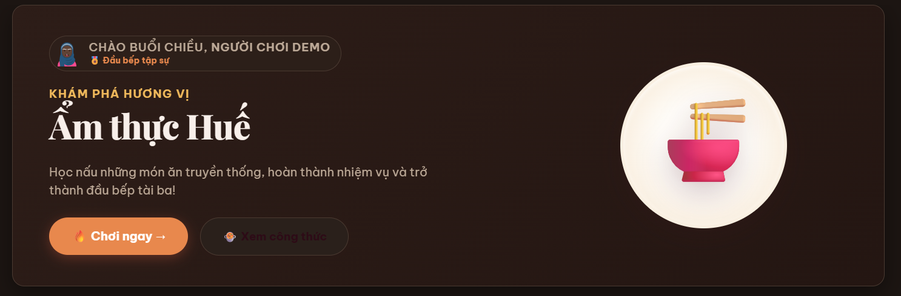,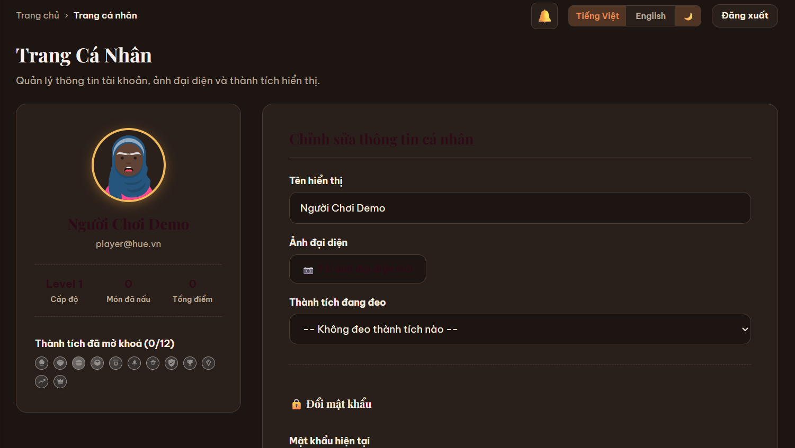,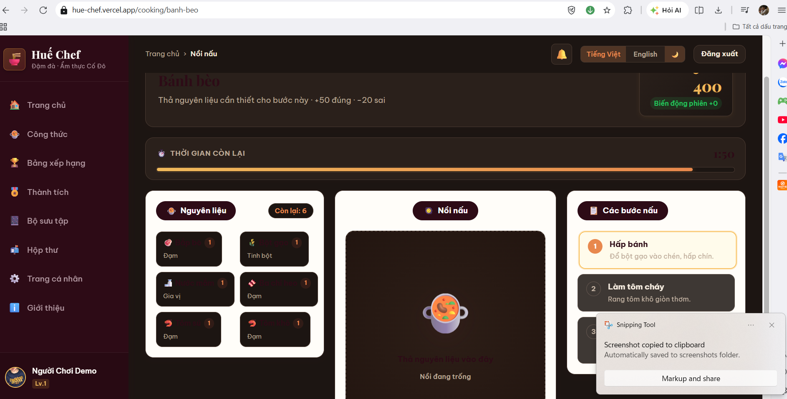,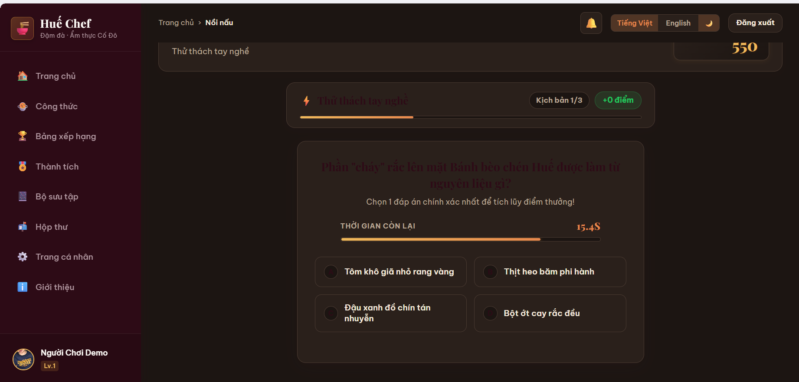
2. 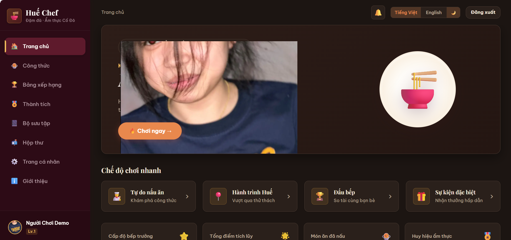
3. 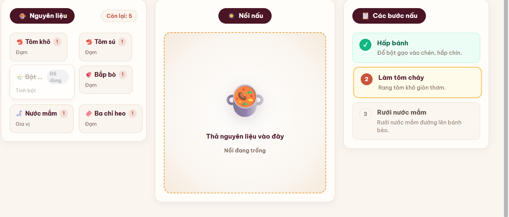
4. 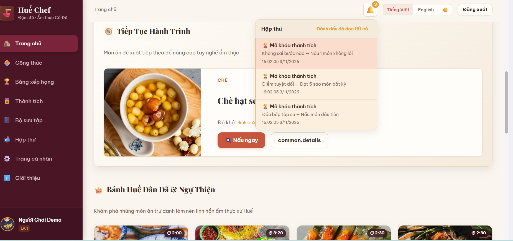,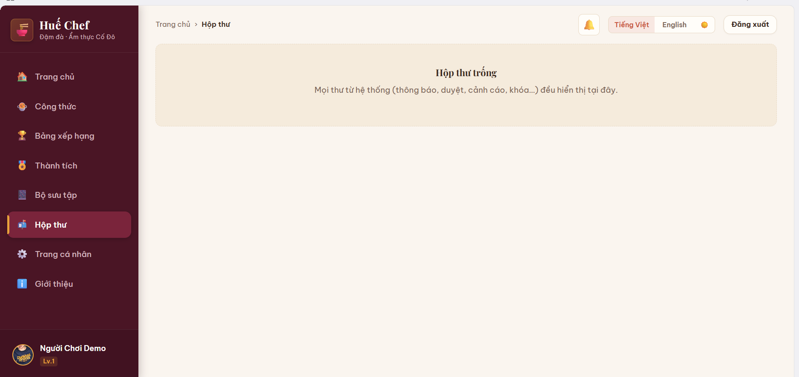
5. 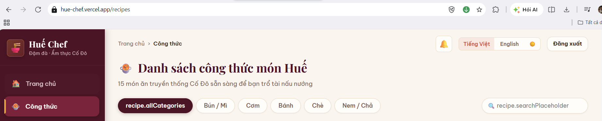
6. 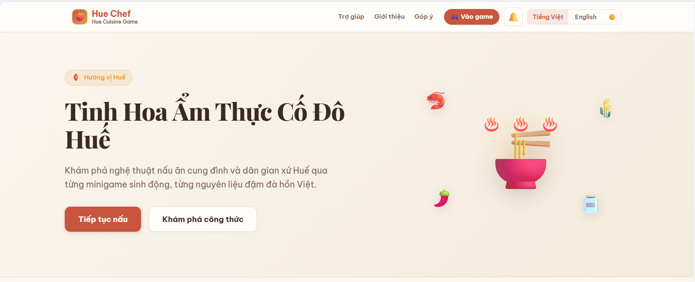
7: 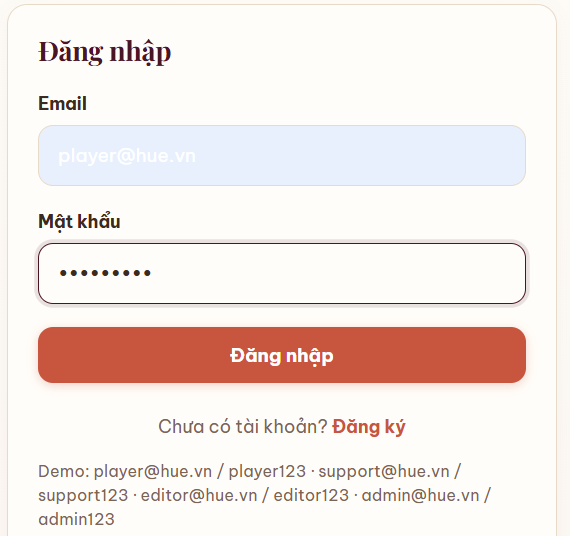
8: 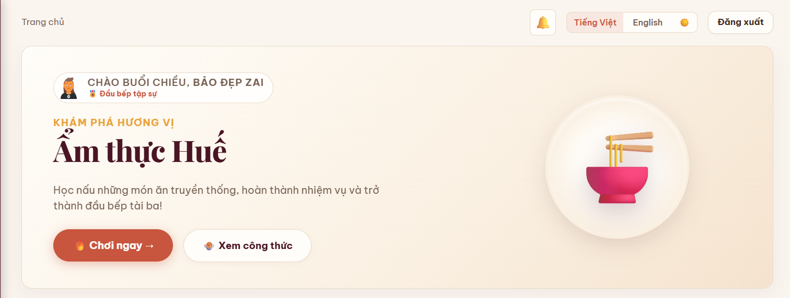

---

## ✅ Báo Cáo Chi Tiết Kết Quả Xử Lý (100% Hoàn Thành)

| Mục | Mô tả lỗi | Trạng thái | Chi tiết kỹ thuật đã thực hiện |
|---|---|---|---|
| **1** | Lỗi màu chữ ở giao diện tối (Dark mode) | ✅ Đã sửa | Đã khắc phục triệt để hiện tượng chữ màu tím mận `--color-plum` (#4A1525) bị tối/đen trên nền tối (#1C1512). Thêm các quy tắc override dark mode chuẩn xác cho `CookingPage`, `StepList`, `CookingPot`, `IngredientTray`, `QuizGame`, `MinigameRunner`, `ProfilePage`, `HomePage`, `Card`, `Modal`, `Button.ghost`. |
| **2** | Lỗi khi lưu ảnh đại diện & tràn layout Hero | ✅ Đã sửa | 1) Sử dụng Canvas tự động resize và center-crop ảnh avatar về chuẩn vuông 256x256 JPEG chất lượng cao, giảm dung lượng từ 3-5MB xuống còn ~25KB, chống hoàn toàn lỗi `QuotaExceededError` của `localStorage`. 2) Bổ sung class `.avatarImg` với `width: 100%; height: 100%; border-radius: 50%; object-fit: cover;` để ảnh đại diện luôn tròn trịa và không bao giờ bị phồng to hay tràn layout banner. |
| **3** | Chip nguyên liệu đã dùng bị phồng | ✅ Đã sửa | Đã loại bỏ hoàn toàn thẻ badge chữ "Đã dùng" trong `IngredientTray.tsx`. Khi nguyên liệu đã được thả vào nồi, chip chỉ áp dụng `styles.chipUsed` với `opacity: 0.38; filter: grayscale(0.5); pointer-events: none;`. Kích thước và bố cục ô chip giữ nguyên vẹn 100%, không bị biến dạng hay phồng to. |
| **4** | Nút đã đọc không bấm được & Hộp thư không đồng bộ | ✅ Đã sửa | 1) Chuyển `NotificationContext.tsx` sang lưu trữ qua React `useState`, đảm bảo khi gọi `markRead` hoặc `markAllReadForUser` sẽ kích hoạt re-render ngay lập tức (badge số và danh sách cập nhật tức thì). 2) Tích hợp `InboxList.tsx` hiển thị hợp nhất cả Thư hệ thống (`MailContext`) và Thông báo thành tích/hệ thống (`NotificationContext`), đồng bộ 3 thư/thông báo ở `/inbox` trùng khớp với chuông thông báo. 3) Sửa phím "Đánh dấu đã đọc tất cả" đánh dấu đã đọc đồng thời cho cả Thư và Thông báo. 4) Khắc phục raw key `common.details` trên nút chi tiết trang chủ thành "Chi tiết" (VI) / "Details" (EN). |
| **5** | Lỗi i18n bộ lọc công thức (`recipe.allCategories`) & tìm kiếm | ✅ Đã sửa | Đã bổ sung đầy đủ các khóa dịch `allCategories` ("Tất cả" / "All") và `searchPlaceholder` ("Tìm kiếm món ăn..." / "Search recipes...") vào `vi.ts`, `en.ts` và `types.ts`. Giao diện tự động chuyển đổi song ngữ mượt mà. |
| **6** | Thiết kế banner động cho Trang Giới Thiệu (`/about`) | ✅ Đã xong | Thiết kế banner Cung Đình Cố Đô Huế cao cấp: Nồi ngự thiện steaming với hiệu ứng khói bốc lên `@keyframes steamRiseAbout`, quỹ đạo bay của các nguyên liệu Huế (`🌶️` ớt, `🦐` tôm, `🌾` lúa, `🏮` đèn lồng, `🪷` hoa sen), vòng hào quang tỏa sáng dịu mắt, hỗ trợ đầy đủ Dark Mode. |
| **7** | Lỗi màu chữ không phù hợp (Autofill form Login) | ✅ Đã sửa | Thêm quy tắc `-webkit-autofill` trong `globals.css` và `AuthLayout.module.css` để buộc trình duyệt luôn hiển thị màu chữ `var(--color-text)` rõ nét trên nền `var(--color-surface)` cả ở Light Mode và Dark Mode. |
| **8** | Thiết kế banner động cho Trang Chủ (`/home`) | ✅ Đã xong | Nâng cấp hero banner trang chủ với hiệu ứng bốc khói 3 làn `@keyframes steamRise`, 5 nguyên liệu đặc sản bay lượn nhẹ nhàng xung quanh bát bún bò Huế, vòng hào quang pulsing `@keyframes auraPulse`, cùng nút khám phá tối ưu tương phản trong Dark Mode. |
